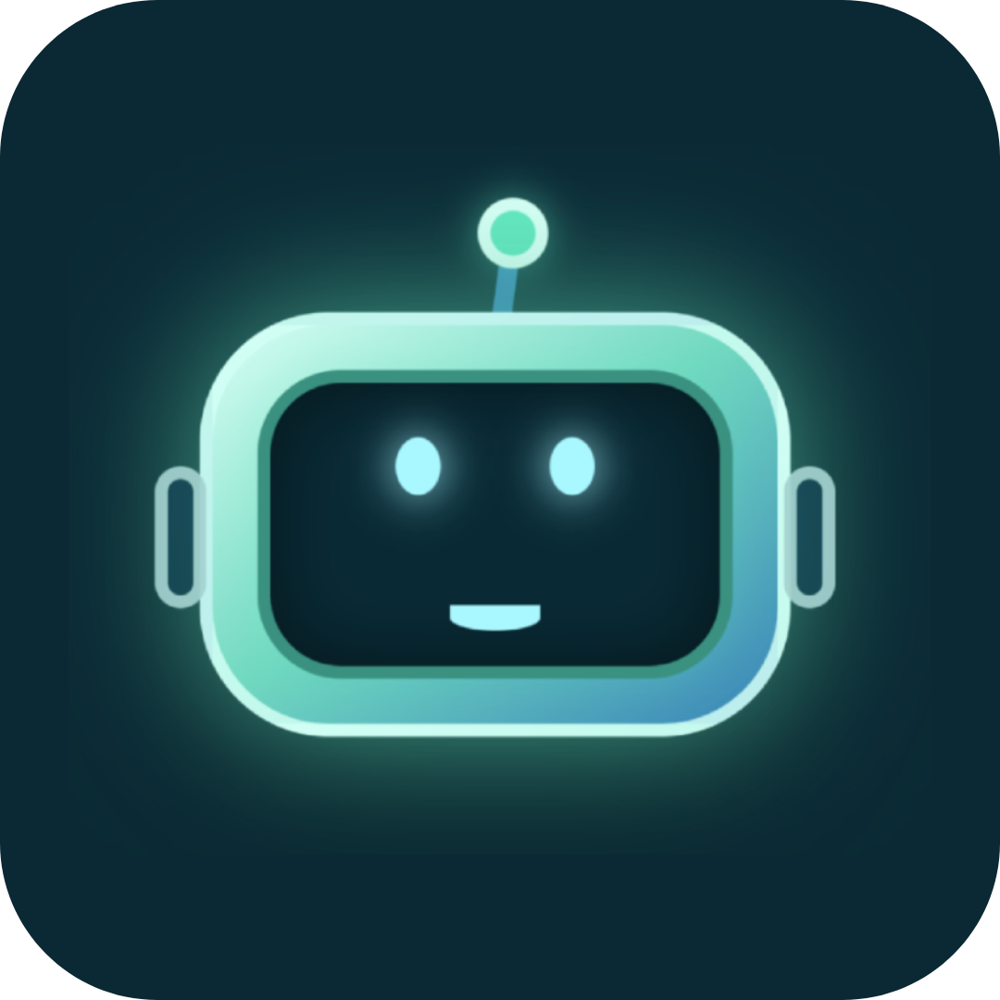
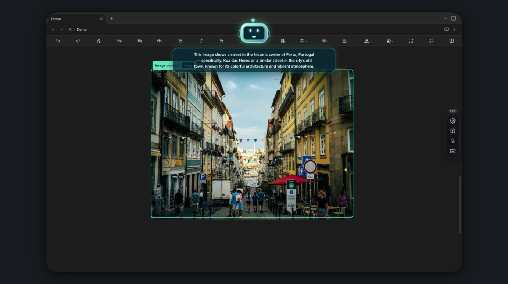
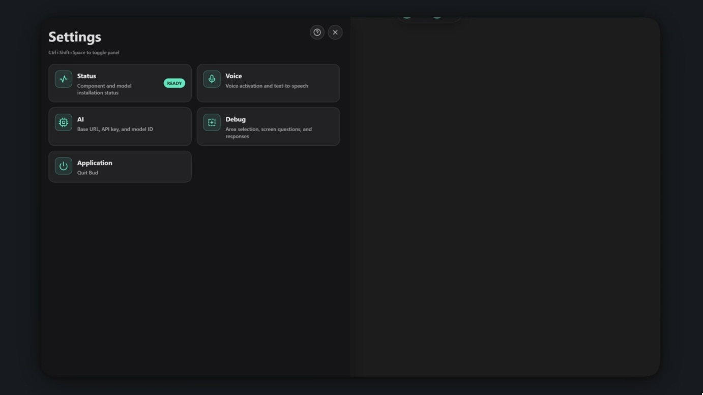
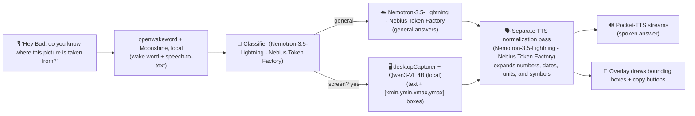

# Bud

<div align="center">

<!-- LOGO PLACEHOLDER -->

<a href="https://github.com/your-username/your-repo-name">
  
</a>

### Built for: Nebius x NVIDIA Global AI Hackathon 2026

Voice-Enabled Virtual Assistant with Screen Vision

[](<>)
[](https://opensource.org/licenses/MIT)

</div>

---

## 📸 Screenshots




---

# Introduction

**Bud** is a voice-first assistant that lives as a translucent overlay on top of the desktop and _sees what you see_. Say **"Hey Bud"**, ask a question naturally, and Bud answers out loud and draws a box around the exact element it is describing.

The key innovation is that Bud is **local-first and smart about where work happens**:

- **Screen understanding runs entirely on-device** on a bundled **Qwen3-VL-4B** vision-language model served by **llama.cpp on the GPU**, and your screen never has to leave your machine for visual tasks.
- **Only general-knowledge questions are routed to the cloud** (a configurable Nebius model), so the common case stays fast and private.
- A lightweight **classifier decides between the two paths automatically** — locally or via its own configurable endpoint — and defaults to screen context whenever the question is ambiguous.
- Everything is **provisioned on first run**: runtime, model weights, and speech models are downloaded automatically and started on free local ports, so there is no manual model setup.

### Using Bud

- **Voice:** Say **"Hey Bud"**, then ask your question. End a conversation with a stop phrase ("stop", "thanks", "that's all", "goodbye") or press Esc.
- **Toolbar:** Move the cursor toward the screen edge to reveal it; drag the grip dots to re-dock it to any edge.
- **Select an area:** Click the select button, drag a box, and Bud focuses (and auto-listens) there. Clear it with Esc or the × button.
- **Type instead:** Use the ask button in the toolbar, or the question field under **Settings → Debug**.
- **Shortcut:** `Ctrl+Shift+Space` toggles the settings panel.

---

## 🔥 Key Features

- 🎙️ **Wake-word voice control:** Hands-free "Hey Bud" activation with confirmation-buffered detection, plus natural stop phrases ("stop", "thanks", "that's all", "goodbye") to end a conversation.
- 👁️ **On-device screen vision:** A bundled Qwen3-VL-4B model (GGUF, CUDA) reads the screen and grounds answers with bounding boxes; no screenshots are sent to the cloud.
- 🧠 **Smart router (screen vs. general):** A lightweight classifier sends visual and system-state questions to the vision model and pure trivia to the Nebius cloud model; it can run on the bundled local model or its own endpoint.
- 🎯 **Visual grounding & copy:** Highlighted indicators point at the elements Bud mentions; when you ask it to read or extract text, a one-click **Copy** button puts the exact raw text on your clipboard.
- 🖱️ **Focus on a region:** Drag a box to confine Bud to part of the screen, then auto-listen in that area. Clear it with Esc or the × control.
- 🗣️ **Low-latency streaming speech:** Answer text is normalized in a **separate pass** by a dedicated TTS-formatting model (local Qwen3-VL or an external endpoint) that expands numbers, dates, units, and symbols into spoken form; Pocket-TTS then streams raw PCM chunks over HTTP and the renderer schedules them through Web Audio for smooth, gapless playback.
- 🫧 **Ambient, non-intrusive overlay:** A transparent, click-through, always-on-top window that becomes interactive only under the cursor, with a toolbar that docks to any edge and hides itself when idle.
- 🖥️ **Multi-monitor aware:** One overlay is placed on every connected display, and a question is answered against the screen the cursor is on, so indicators, region selection, and the drawn answer all land on that display. Each screen remembers its own toolbar position, while the settings panel is shown on a single display at a time.
- 🧭 **Guided first-run experience:** A step-by-step spotlight tour, a readiness dashboard that gates features until components are ready, and a settings panel (Status, Voice, AI, Debug, Application).
- 📦 **Zero-config provisioning:** The llama.cpp runtime, the GGUF model + vision projector, and the speech models are downloaded and started automatically on free local ports, with live progress in **Settings → Status**.

---

## 🛠️ Tech Stack & Architecture

### Technologies Used

- **Desktop & Frontend:** Electron 39, React 19, TypeScript, electron-vite, hand-written CSS (glassmorphic overlay), Web Audio API
- **Orchestration / Backend:** Node.js in the Electron main process, typed IPC over a `contextBridge` preload
- **Screen vision (local):** llama.cpp `llama-server` (CUDA 12.4 build) serving **Qwen3-VL-4B-Instruct** GGUF (`Q4_K_M`) with a `Q8_0` mmproj vision projector
- **Wake word & Speech-to-Text (local):** Python: `openwakeword` (custom `hey bud` model), Moonshine small streaming recognizer, `pvrecorder`
- **Text-to-Speech (local):** Python: Pocket-TTS behind a FastAPI/uvicorn server with a chunked `/tts-stream` PCM endpoint
- **TTS normalization (separate pass):** A dedicated text-normalization model (the bundled local Qwen3-VL or a configurable external OpenAI-compatible endpoint) rewrites answers into spoken form before synthesis, with a regex fallback
- **General-knowledge LLM:** Nebius AI Studio / Token Factory (OpenAI-compatible API), configurable base URL, key, and model
- **AI client:** OpenAI Node SDK, pointed at either the local server or Nebius
- **Packaging:** electron-builder + PyInstaller (Python speech backends staged into `build/python`; model weights and the llama.cpp runtime are downloaded on first launch)
- **Target platform:** Windows x64 with an NVIDIA CUDA GPU (single-GPU, fully local inference)

### How It Works



The spoken answer is **normalized in a separate pass** before it reaches the speech engine: once the router produces an answer, a dedicated TTS-formatting model rewrites it into speakable text (e.g. `10/13/2026` → "October thirteenth, twenty twenty-six"), so numbers, dates, units, and symbols are read correctly. This normalization step has its **own model configuration**: point it at the bundled local Qwen3-VL, or at an external OpenAI-compatible endpoint, independently of the general-answer model. If no normalization model is configured (or the request fails), Bud falls back to a built-in regex cleanup so speech is never blocked.

All capture and inference for screen questions stay on the machine; only general-knowledge prompts reach the network. The always-on-top overlay sets content protection so Bud is excluded from its own screen captures.

---

## 🏃 Quick Start (Run Locally in 2 Minutes)

Follow these simple steps to run the project locally for testing during evaluation. The first launch downloads the vision model and runtime automatically, so let it finish; progress is always visible in **Settings → Status**.

### 1. Prerequisites

- **OS:** Windows 10/11 x64 (the bundled llama.cpp runtime and preparation scripts target Windows)
- **Node.js:** `>= 18.0.0` (Node 22 recommended)
- **Package Manager:** `pnpm` (lockfile included) or `npm`
- **uv:** manages Python 3.12 for the speech backends (the prepare scripts run via `uv run`)
- **GPU:** NVIDIA GPU with a recent CUDA 12.x driver (for local Qwen3-VL inference)
- **Disk:** ~10 GB free for the runtime, models, and Python bundles, plus enough free VRAM for a 4B model

### 2. Setup & Installation

```bash
# Clone the repository
git clone https://github.com/bud-2026/bud.git
cd bud

# Install dependencies
pnpm install
# (or: npm install)

# Configure environment variables
cp .env.example .env
```

Edit `.env` and set the general-knowledge model credentials (only required for general questions):

```env
GENERAL_BASE_URL=https://api.tokenfactory.nebius.com/v1/
GENERAL_API_KEY=your_general_api_key
GENERAL_MODEL_ID=your_general_model_id
```

Optionally configure question classification separately. Leave these blank to reuse the general settings above, or set `CLASSIFICATION_USE_LOCAL=true` to classify on the bundled local model:

```env
CLASSIFICATION_BASE_URL=
CLASSIFICATION_API_KEY=
CLASSIFICATION_MODEL_ID=
CLASSIFICATION_USE_LOCAL=
```

Optionally configure the separate TTS normalization pass (see **How It Works**). Leave these blank to skip the extra model call and use the built-in regex cleanup, or set `PHONETIC_USE_LOCAL=true` to run it on the bundled local model:

```env
PHONETIC_BASE_URL=
PHONETIC_API_KEY=
PHONETIC_MODEL_ID=
PHONETIC_USE_LOCAL=false
```

> Screen analysis always runs on the bundled local Qwen3-VL server; no key is needed for that.

### 3. Prepare the Backends (Windows, one time)

For development, create the Python virtual environments and install the speech dependencies:

```bash
pnpm run setup:dev
```

To produce the packaged backends instead, `prepare:backends` additionally freezes them with PyInstaller into `build/python`. Model weights and the llama.cpp runtime are **not** staged; the packaged app downloads them on first launch, which keeps the installer small at the cost of a first-run network connection:

```bash
pnpm run prepare:backends
pnpm run validate:backends
```

### 4. Run the App

```bash
pnpm run dev
```

Bud shows a splash while it starts the speech backends and the local vision server. On first use it downloads the vision weights, the speech models, and (on first launch) the llama.cpp CUDA runtime into your user-data folder; watch **Settings → Status**. This requires an internet connection the first time. Once the Status panel reads "Bud is ready", say **"Hey Bud"**, or hover the edge of the screen to reveal the toolbar.

### 5. Build a Desktop Installer

```bash
pnpm run build:win     # Windows NSIS installer
pnpm run build:unpack  # unpacked build for quick testing
```

### Configuration Reference

| Variable                   | Purpose                                           | Default                                   |
| -------------------------- | ------------------------------------------------- | ----------------------------------------- |
| `GENERAL_BASE_URL`         | OpenAI-compatible base URL for general knowledge  | `https://api.tokenfactory.nebius.com/v1/` |
| `GENERAL_API_KEY`          | API key for the general model                     | (none)                                    |
| `GENERAL_MODEL_ID`         | Model ID used for general answers                 | (none)                                    |
| `CLASSIFICATION_BASE_URL`  | Base URL for the question classifier              | (general settings)                        |
| `CLASSIFICATION_API_KEY`   | API key for the question classifier               | (general settings)                        |
| `CLASSIFICATION_MODEL_ID`  | Model ID for the question classifier              | (general settings)                        |
| `CLASSIFICATION_USE_LOCAL` | Run classification on the bundled local model     | (general settings)                        |
| `PHONETIC_BASE_URL`        | Base URL for the separate TTS normalization model | (none) (regex fallback)                   |
| `PHONETIC_API_KEY`         | API key for the TTS normalization model           | (none)                                    |
| `PHONETIC_MODEL_ID`        | Model ID for the TTS normalization pass           | (none)                                    |
| `PHONETIC_USE_LOCAL`       | Run TTS normalization on the bundled local model  | `false`                                   |

General settings, question classification, and the TTS normalization model can also be changed at runtime under **Settings → AI** (the "General responses", "Question classification", and "Phonetic formatting" groups), which persists them to `ai-settings.json` in the app's user-data folder.
